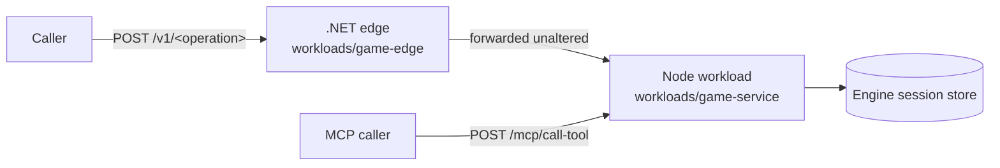

# Hosting the Game Engine

G1 put the Game Engine behind a network boundary and proved that doing so did not change the
game. It delivered two processes: a Node service in `workloads/game-service/` that exposes one
engine session store as a JSON wire and as an MCP tool set, and a .NET edge in
`workloads/game-edge/` that fronts the wire. Neither holds game logic. The proof that matters is
byte-identity: the same scripted playthrough, run in-process and run against the hosted service,
leaves the engine's store holding the same bytes.

This page is the map. It covers the shape, the two surfaces, the error model, the proof, how to
run it, and what will surprise you. The exact schemas, signatures and numbered invariants are in
[`20-contract.md`](https://github.com/The-Running-Dev/SubZeroDev.Platform/blob/main/design/g1/20-contract.md).
Who owns what between engine and host is the
[Engine Hosting Contract](engine-hosting-contract.md); the product this serves is
[Game Engine as a Service](game-engine-as-a-service.md).

## The shape

The workload consumes the engine package and a vendored contract package. It adds transport and
nothing else: no persistence of its own in G1, no principals, no tenancy, no billing, no human
UI, and no deployment machinery. It listens on loopback unless told otherwise, and nothing here
describes a production deployment because none exists.

Process startup is deliberately ordered. The workload loads the contract, asserts the contract's
recorded engine version against the engine it resolved, builds both surfaces from the table, and
only then binds the listener. A version mismatch exits non-zero with a named error and the
listener never binds; so does a contract whose major version the workload does not support.

## The operation table

Both surfaces are generated from one table of rows, **held as data** in the external
`SubZeroDev.ServiceContract` repository and consumed here as the vendored package
`@subzerodev/service-contract` 0.8.0. Nothing in this repository authors, edits or regenerates
it, and request and response schemas are generated from the engine's own types. Removing a row
removes a route and a tool together. The current table has thirteen rows:

| Operation (`POST /v1/…`) | MCP tool | Engine method |
|---|---|---|
| `list-campaigns` | `list_campaigns` | `listCampaigns` |
| `get-scene` | `get_scene` | `getScene` |
| `get-view` | `get_state` | `getView` |
| `get-strings` | `get_strings` | `getStrings` |
| `list-saves` | `list_saves` | `listSaves` |
| `preview-action` | `preview_action` | `previewAction` |
| `create-session` | `start_game` | `createSession` |
| `resume-session` | `continue_game` | `resumeSession` |
| `submit-action` | `choose` | `submitAction` |
| `save-game` | `save_game` | `saveGame` |
| `load-game` | `load_game` | `loadGame` |
| `delete-save` | `delete_save` | `deleteSave` |
| `branch-session` | `branch_session` | `branchSession` |

The table has grown since the brief: it was nine operations, then ten, and `list-saves`,
`delete-save` and `branch-session` arrived with engine 0.10.0. The tool names are a naming
choice no type expresses (`submitAction` is `choose`), which is why the table is authored data
and not derived. Rows also carry *narrowings* — fields of the engine's signature deliberately
not exposed — and both surfaces inherit them. `create-session` drops `audience` from the
request; `save-game` returns only the save id, dropping `savedAtSeq`.

The MCP tool contract itself lives in
[SubZeroDev.ServiceContract](https://github.com/The-Running-Dev/SubZeroDev.ServiceContract),
not here.

## The two surfaces

**The JSON wire.** Every operation is `POST /v1/<operation>` with a JSON object body. There are
no `GET`s and no resource-shaped routes, because `previewAction` takes an arbitrary parameter
object with no defensible URL encoding, and one uniform rule beats one rule with an exception.
The cost is no HTTP caching and no method-level idempotency, both of which are non-goals.

**MCP.** The same process serves MCP over HTTP: `POST /mcp/list-tools` (no body) and
`POST /mcp/call-tool` with `{ "name": …, "arguments": … }`. There is no version segment. The tool
count equals the row count, and a tool call validates against the same request schema and calls
the same dispatcher as the wire. A separate stdio process was rejected because it would compose a
second store, and two surfaces that disagree about which sessions exist are not one service.

Both surfaces share one dispatcher that **holds no game logic**: it binds validated arguments to
the engine method, applies the row's response narrowings, translates the engine's error, and
nothing more. It does not retry, does not reinterpret a reason code, and caches nothing.

Two probes sit outside the table. `GET /livez` is always healthy; `GET /readyz` is healthy only
once the surfaces are built, the listener is bound and the store answers. Both return
`{ "status": … }`, `200` when healthy and `503` when not.

### There is no raw-state endpoint

Responses carry a projected Scene, never the engine's serialized envelope. That absence is
permanent, not deferred, and a test gates it: neither surface can import the one module that can
produce raw engine state, so a route cannot return what its module cannot name.

## The error model

The engine's error codes travel **verbatim** as the body `code`, plus a closed set of
transport-only codes. A client renders the code and never parses the message. The body is a
canonical-encoded envelope of exactly two members, `{ "code", "correlation" }`, and the same
correlation is on the `x-correlation-id` response header. Correlation is the trace-id of the
inbound `traceparent`, or a fresh one if it is absent or malformed. The envelope never carries
exception text or payload content.

| Status | Codes |
|---|---|
| `400` | `malformed_payload` |
| `404` | `unknown_session`, `unknown_save`, `unknown_campaign`, `unsupported_version`, `unknown_operation`, `session_expired`, `save_expired` |
| `409` | `invalid_state`, `unknown_kind`, `save_requires_migration`, `migration_failed`, `concurrent_modification`, `invalid_fork_point` |
| `500` | `internal_failure` |
| `503` | `storage_failure` |

Status is a function of the code through a mapping held in the contract, with no default branch.
A code with no mapping becomes `internal_failure` rather than a silent 500. A response that
fails its own closed schema also becomes `internal_failure`, so an unvalidated body is never
returned.

What each transport-only code means: a non-`POST` method or a path that is not exactly two
segments is `unknown_operation`; a wrong version segment is `unsupported_version`; an unparsable
body or a request that fails its closed schema is `malformed_payload`, and in that case the store
is never reached. Request bodies are capped at 1 MiB.

**A rejected game action is a `200`.** An unknown action id or an unmet requirement comes back
as the store's own unsuccessful result, not a `4xx`. HTTP status describes whether the transport
delivered the operation's result, never the game's verdict on it. A caller must read the result
to tell success from rejection.

The edge adds two codes of its own, `workload_unreachable` (`503`) and `workload_timeout`
(`504`), described next.

## The edge

The edge is a single .NET host composed by Platform's standard `AddPlatformWebHost()` call. It
adds a catch-all forwarding route and one readiness check, and nothing else. It does not rewrite
the path, inspect the body or know which operation it carries, and it returns the workload's
response byte for byte. It sets the outbound `traceparent` from the ambient trace context so one
trace spans both processes. Its configuration is the `GameEdge` section; only
`WorkloadBaseAddress` is required. Options, streamed-route handling and its counters are in
`workloads/game-edge/`, and are not restated here.

- **No retry, ever.** A retried `submit-action` is a second action. After a `504` the caller
  re-reads with a query operation and decides; it does not resubmit.
- **Readiness follows the workload.** `/health/ready` probes the workload's `/readyz` and
  reports unhealthy when it cannot, so an edge that can serve nothing says so. `/health/live`
  never touches the workload, so an orchestrator is never told to restart the edge for a fault
  it cannot fix.
- **Cookies are disabled** on the forwarding client, so one caller's session cookie is never
  handed to the next ([#339](https://github.com/The-Running-Dev/SubZeroDev.Platform/issues/339)).
- **A dependency-direction gate** fails the build if anything under `src/` or `samples/`
  references `workloads/`. The edge reaches the workload over a socket and references none of it.

## The byte-identity proof

G1's central question was whether hosting changes the game. The proof scripts one fixture, a
thirteen-step playthrough with one step per operation, and plays it two ways: **in-process**
through the same dispatcher the surfaces use, and **hosted**, against a real workload process
over real HTTP, strictly sequentially with no retry and no normalization. Both runs use a replay
determinism profile: counting id sources for the engine's ids and for session and save record
ids, and a fixed clock.

Two comparisons, asserted separately because neither answers the question alone:

- **A, the engine invariant.** The hosted store's serialized blobs, written to a file at graceful
  shutdown, against the in-process run's, blob for blob, in id order, with no ignore list.
- **B, the wire.** The hosted response transcript against the committed
  `tests/fixtures/golden-transcript.json`, byte for byte. The in-process transcript is held to
  the same file, so one artifact carries both claims.

A suite that has never gone red proves nothing, so two perturbations are in the suite: transposing
two steps must fail A, and substituting one response member must fail B. A coverage check fails
the proof if the fixture's operations differ from the table's rows, and an empty set cannot
compare equal to another empty set. Stage 2 re-runs both comparisons with the client addressing
the edge.

The determinism profile is startup configuration only, never a request field, header or route,
and a default start writes no dump. To get the proof's ids reproducible the engine gained one
seam: a host-suppliable source for session and save ids.

## Where G2 took this

G1's sessions lived in a map inside the workload process: fast, and gone on restart. G2 replaced
that with a PostgreSQL store, and **the in-memory layer is no longer a supported deployment
shape**. It remains as the fixture the replay proves against. The two configurations are not
wire-equivalent under concurrency; see [Durable Sessions](guide.md) before building on either.
`concurrent_modification`, `session_expired` and `save_expired` in the table above come from G2.

## Run it locally

The commands are in the
[game-service README](https://github.com/The-Running-Dev/SubZeroDev.Platform/blob/main/workloads/game-service/README.md),
which CI runs verbatim in the `game-service` job. It needs Node.js 24 or later and the .NET SDK
10.0.x. In outline:

1. **Install and start the workload**: `npm install`, then `npm start` in `workloads/game-service`.
   It listens on `127.0.0.1:8080`. `GAME_SERVICE_PORT` and `GAME_SERVICE_HOST` override that, and
   `Ctrl+C` shuts down gracefully.
2. **Build and start the edge**: `dotnet build` the edge project, then run the built DLL from its
   own directory with `GameEdge__WorkloadBaseAddress` pointing at the workload. Run it from there
   because `appsettings.json` resolves against the working directory, and the timeout defaults
   live only in that file.
3. **Run the proof**: `npx vitest run tests/replay.test.ts` for the single hop and
   `tests/replay-edge.test.ts` for the edge. Each spawns and tears down its own processes, so
   nothing needs to be started first.

Other startup variables are `GAME_SERVICE_OTLP_ENDPOINT` (unset means no exporter and no outbound
connection), and, for the durable store, `GAME_SERVICE_STORAGE=durable` with
`GAME_SERVICE_DB_CONNECTION_STRING`. The README's sections cover provisioning the store, the
contention proofs and the port-conformance suite.

## Things that will surprise you

- **You cannot see the contract here.** The table, schemas and status mapping live in another
  repository. Both packages are vendored as tarballs in `workloads/game-service/vendor/` because
  neither is on a public registry yet
  ([#81](https://github.com/The-Running-Dev/SubZeroDev.Platform/issues/81)). The engine tarball
  moves in lockstep with the contract's recorded engine version, and a mismatch stops startup.
- **A second in-memory instance looks like missing data, not corruption.** Each instance holds
  its own sessions, so a session created on one is `unknown_session` on the other. Nothing
  enforced single-instance in G1.
- **The design leaves MCP out of the edge, but the code forwards it.** G1's design routes only the
  JSON wire through the edge and names MCP as a stated gap. The forwarding route maps every path,
  though, so `/mcp/*` reaches the workload through the edge like anything else, and the edge does
  nothing MCP-specific. Whether the edge should cover MCP is left open for G3, which enforces
  authorization at the edge.
- **The edge cannot reject an unknown operation.** It forwards every path and does not read the
  contract, so `unknown_operation` always comes from the workload.
- **A forward that fails after the headers arrive is still `workload_unreachable`.** A workload
  that dies mid-response is the same lost hop to the caller as one that never connected.
- **The engine writes its in-memory record before it writes through to persistence.** A
  persistence layer that can fail therefore leaves the record ahead of the store. G1's map-backed
  persistence could not fail, so `storage_failure` was unreachable there; G2's can.
- **There is no way to ask the workload for raw state**, whatever the reason. The determinism dump
  is a file written at shutdown, unreachable by any caller.

## Where to look next

- [`20-contract.md`](https://github.com/The-Running-Dev/SubZeroDev.Platform/blob/main/design/g1/20-contract.md) — exact signatures, every error variant, and the numbered invariants.
- [`10-design.md`](https://github.com/The-Running-Dev/SubZeroDev.Platform/blob/main/design/g1/10-design.md) — the reasoning behind each choice, with the alternatives rejected.
- [`90-decisions.md`](https://github.com/The-Running-Dev/SubZeroDev.Platform/blob/main/design/g1/90-decisions.md) — the dated decision log.
- [Durable Sessions](guide.md) — what G2 changed, and the guide that assumes this one.
- [Engine Hosting Contract](engine-hosting-contract.md) — the ownership split between engine and host.
